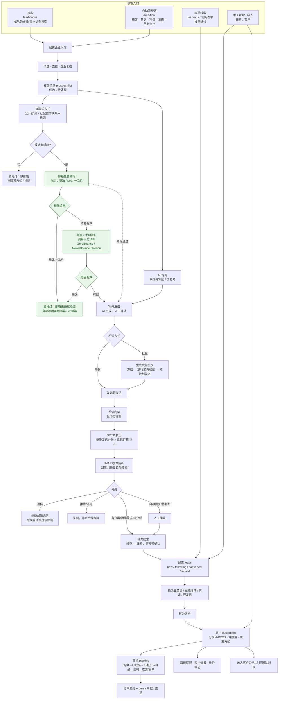
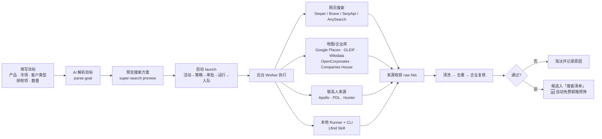
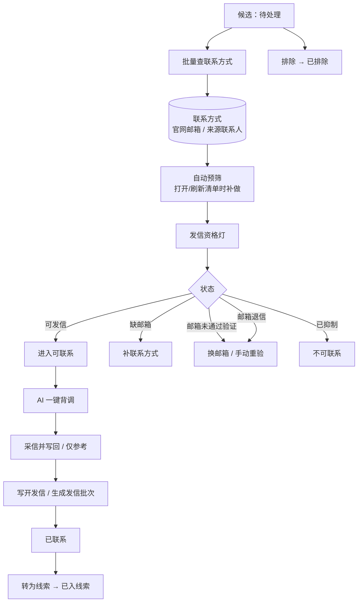
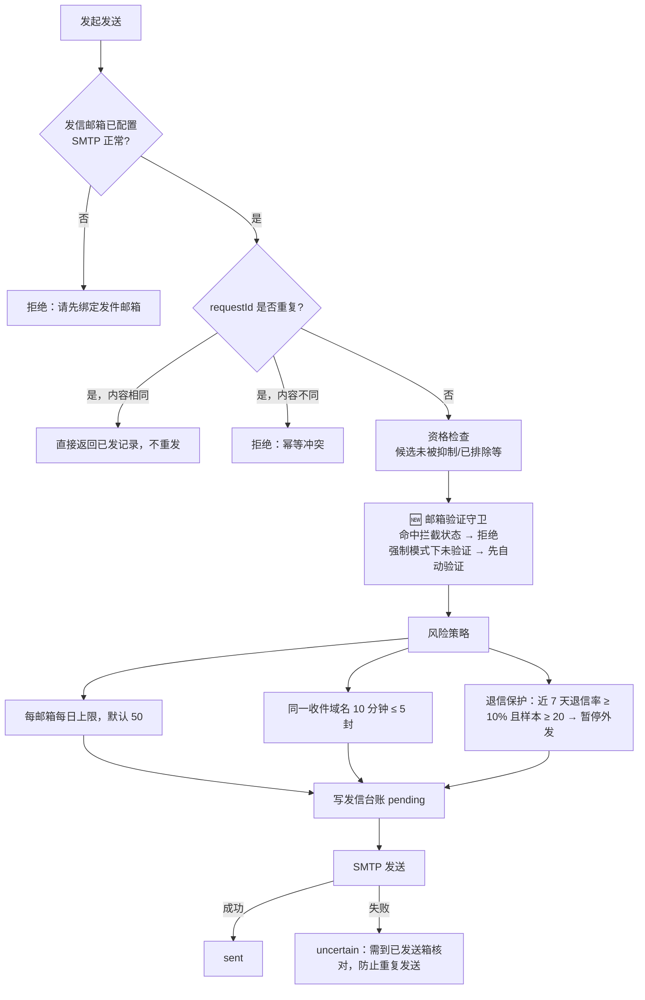
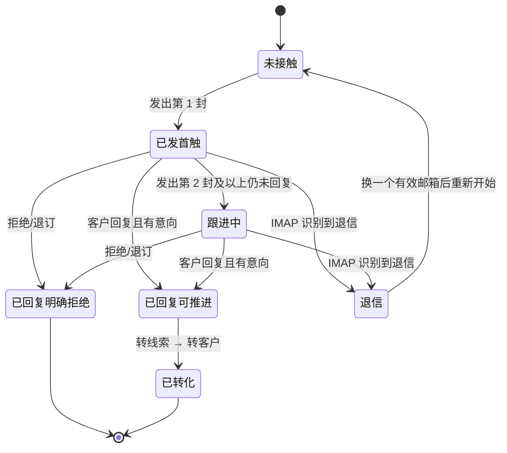
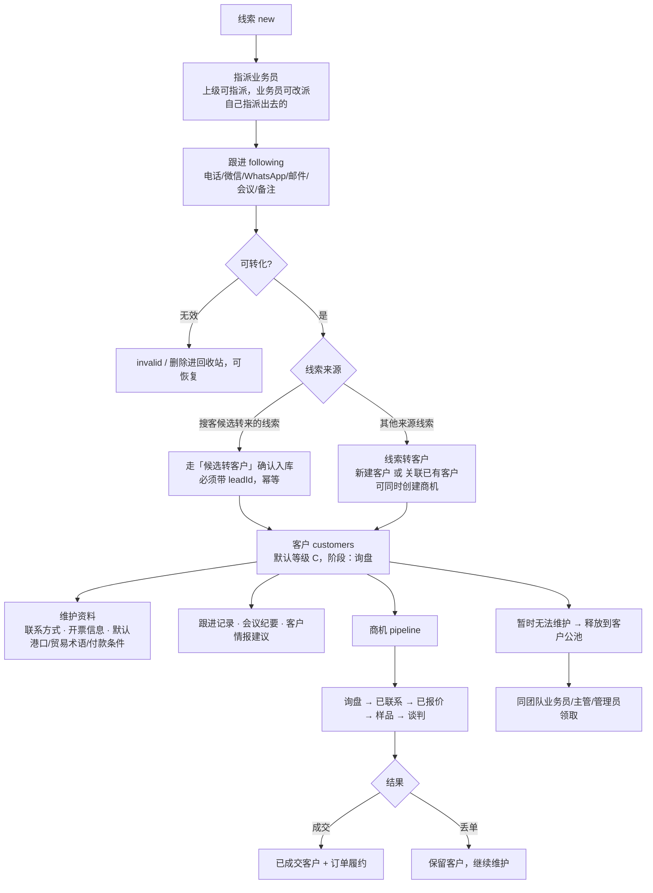

# GoodJob CRM：从搜客到客户管理 —— 流程图与使用说明书

> 范围：获客（搜客 / 自动流 / 表单线索）→ 搜客清单 → 联系方式与邮箱验证 → 背调 → 开发信 → 回信/退信回流 → 线索 → 客户 → 商机/订单/公池。
> 流程图使用 Mermaid 语法，可在 GitHub、VS Code（Markdown Preview Mermaid 插件）、Typora、Obsidian 中直接渲染。

---

## 一、总览流程图

绿色节点为本次新增的「发信前邮箱验证」。

---

## 二、分阶段详图

### 2.1 搜客阶段（获客 → 候选入库）

要点：
- 搜客任务有进度、来源收获、去重、清洗淘汰的完整统计，可在搜客页持续查看。
- 没有配置 API 的来源会显示 Not configured，不影响其他来源运行。

### 2.2 候选处理阶段（搜客清单）

清单标签页：全部 / 待处理 / 可联系 / 已联系 / 已入线索 / 已排除。

### 2.3 发信门禁（每一封外发邮件都会经过）

批次发送的额外保护：每日上限（默认 20）、步骤间隔（默认 72 小时）、发送窗口（默认 9–11 点）、本批次退信率超过 5% 自动暂停、收到回复自动停止该候选剩余步骤。

### 2.4 回信 / 退信回流（开发信状态机）

后台每 2 分钟轮询各业务员收件箱（回溯 7 天），用 Message-ID / In-Reply-To 把回信、退信挂回对应开发信；分类保守，拿不准的一律标「自动回复 / 待判断」交人工确认。

### 2.5 线索 → 客户 → 商机 → 订单

---

## 三、使用说明书

### 3.1 前置准备（只需做一次，管理员）

| 项目 | 位置 | 说明 |
| --- | --- | --- |
| 发件邮箱 | 个人信息 / 邮件中心 → 绑定邮箱 | 配置 SMTP（发信）和 IMAP（收回信/退信）。QQ 等邮箱需使用「授权码」而非登录密码 |
| 发件域名认证 | 个人信息 → 域名检测 | 检查 SPF / DKIM / DMARC，未通过会大幅增加退信和进垃圾箱的概率 |
| 搜客来源 | 系统配置 → AI配置 → 搜客数据源 | 配置 Serper、Brave、Google Places 等。搜客页的快捷按钮会直接打开对应来源。 |
| AI 模型 | 系统配置 → AI配置 → AI 模型 | 保存模型配置后，点击「设为当前」。每个账号同一时间只有一个当前模型。 |
| AI 执行来源 | 系统配置 → AI配置 → AI 执行来源 | 设置背调与开发信的默认来源，以及本地 CLI 与 Runner。 |
| 邮箱验证 | 系统配置 → AI配置 → 邮箱验证 | 见 3.4，仅管理员可改 |
| 退信保护 | 邮件中心 → 邮箱设置 → 退信保护 | 默认：近 7 天退信率 ≥ 10%（样本 ≥ 20）暂停外发 |

### 3.2 第一步：搜客

1. 左侧菜单「获客 → 搜客」。
2. 填写目标：产品、目标市场、客户类型，必要时填排除项和数量，先点预览确认方案再启动。
3. 启动后保持在页面查看进度；也可以稍后在任务列表查看。
4. 想一条龙完成「获客 → 背调 → 写信 → 发送 → 回复监控」，用「自动流获客」。注意：自动流的发送节点**必须人工确认**，不会自动群发。
5. 搜出的候选会进入「搜客清单」，并**自动做免费邮箱预筛**。

### 3.3 第二步：在搜客清单处理候选

左侧菜单「获客 → 搜客清单」。

1. **看标签页**：待处理 / 可联系 / 已联系 / 已入线索 / 已排除。
2. **补联系方式**：勾选候选 → 「批量查联系方式」。系统先用公开官网信息，再用已配置的联系人来源。
3. **看发信资格灯**（每个候选名称下的标签）：
   - 「可发信」：可以发。
   - 「缺邮箱」：先补联系方式。
   - 「邮箱未通过验证」：邮箱无效或一次性，悬停看原因；有备用邮箱时会自动改用备用邮箱。
   - 「邮箱退信」：此前发信退过信，同样会自动尝试备用邮箱。
   - 「已抑制」：对方退订/拒绝/被排除，不可联系。
   - 灯后面的小标签是**邮箱验证状态**，见下表。
4. **背调**：打开候选详情，点「AI 一键背调」，结果选择「采信并写回」（把可信的公司信息/联系方式写入候选）或「仅参考」。
5. **写开发信**：详情页底部「开发信工作区」，选择撰写方式后点「AI 生成」，修改主题和正文，确认后「发送开发信」。
6. **批量发信**：勾选多个候选 → 「生成发信批次」。批次先生成草稿，确认后**冻结并放行**，系统按计划（每日上限、间隔、发送窗口）自动发。放行前会再次复核资格并验证收件人邮箱，不合格的会被剔除并写明原因。
7. **其他操作**：「排除」不合格候选；「分配」给业务员；「保存候选资料」手工修正；「记录回复」「补录历史触达」登记线下沟通。
8. **转线索**：候选有回应或确认有价值时，点「转为线索」（单个）或「批量转为线索」。

### 3.4 邮箱验证（预防退信）

**两层机制**

| 层级 | 触发 | 做什么 | 费用 |
| --- | --- | --- | --- |
| 免费预筛 | 候选入库后自动；打开/刷新搜客清单时补做 | 语法、MX 记录（无 MX 时看 A/AAAA）、一次性邮箱域名、角色邮箱前缀 | 免费 |
| 第三方 API | **只在手动点验证时** | ZeroBounce / NeverBounce / Reoon 确认邮箱是否真实存在 | 按次计费 |

> 免费预筛只能挡明显无效的地址，**查不出邮箱是否真实存在**。要大幅降低退信，必须接入第三方 API 并对要发信的邮箱做手动验证。

**手动验证入口**

- 搜客清单：勾选候选 → 「验证邮箱」。
- 候选详情 → 开发信工作区 →「收件邮箱」右侧「验证」按钮；已验证过的直接显示状态，不重复收费。
- 客户列表：勾选客户 →「批量验证邮箱」。
- 客户详情抽屉 / 详情页「联系中心」：邮箱旁的「验证」按钮。
- 发信批次放行时会自动验证收件人。

**状态含义**

| 标签 | 含义 | 默认是否拦截发信 |
| --- | --- | --- |
| 已验证有效 | 第三方确认邮箱存在 | 放行 |
| 域名有效 | 仅预筛通过：域名能收信，邮箱本身未确认 | 放行 |
| 邮箱无效 | 语法错误、无 MX、或第三方判定不存在 | **拦截** |
| 一次性邮箱 | 临时邮箱 | **拦截** |
| 全收域名 | 域名对任何地址都说收到，真实性无法确认 | 放行（可在设置里改为拦截） |
| 无法确认 | DNS 临时故障或第三方无结论 | 放行（可改） |
| 角色邮箱 | info@ / sales@ 等公共邮箱，回复率较低 | 放行（可改） |
| 未验证 | 还没有结果 | 放行（强制模式下需先验证） |

**设置项**（系统配置 →「AI配置」→「邮箱验证」，仅管理员）

- 启用开关：关闭后不预筛、不拦截。
- 第三方服务：不使用 / ZeroBounce / NeverBounce / Reoon，以及 API Key（加密保存，页面不回显；留空保存表示沿用）。Reoon 使用 Power 模式，单次可能需要数秒到约一分钟。
- 验证有效期（默认 30 天）：有效期内同一邮箱不重复调用 API。
- 拦截哪些结果：默认「邮箱无效」「一次性邮箱」。
- 「未验证的邮箱禁止发送」：最严格，发送时自动先验证（可能产生费用和延迟；验证服务异常时保守拒发）。

### 3.5 第三步：线索管理

左侧菜单「线索」。

- 线索来源：搜客候选转入、表单线索（「获客 → 表单线索」/官网表单进线）、手工新增、导入。
- 状态：新线索 → 跟进中 → 已转化 / 无效。
- 指派：持有指派权限的上级可指派任意线索；业务员只能改派自己指派出去的线索。
- 跟进：记录电话 / 微信 / WhatsApp / LinkedIn / 邮件 / 会议 / 备注；也可做背调、写开发信。
- 删除进入回收站，可恢复；永久删除需单独操作。

### 3.6 第四步：转为客户

- **搜客候选转来的线索**：必须通过「候选转客户」确认入库（需选择新建客户或关联已有客户），不能走普通线索转客户。
- **其他来源的线索**：在线索详情点转化，可选「新建客户」或「关联已有客户」，并可勾选同时创建商机。系统会先给出可能重复的客户匹配供你参考。
- 转化是幂等的，重复点击不会产生重复客户；已转化的线索再次转化会返回原客户。
- 新建客户默认等级 C、阶段「询盘」，资料可继续补全。

### 3.7 第五步：客户管理

左侧菜单「客户管理」。

| 菜单 | 用途 |
| --- | --- |
| 未成交客户 / 已成交客户 | 客户列表。点客户行打开右侧抽屉，可「写开发信」「AI 背调」「新增跟进记录」「编辑客户」「放入公池」；也可进入完整详情页 |
| 订单履约 | 成交后的订单、单据、出运 |
| 客户公池 | 暂时无法维护的客户可释放到公池；同团队业务员 / 主管 / 管理员可领取。释放前系统检查是否仍有活跃商机，并记录原因 |
| 同行管理 | 竞争对手信息 |
| 跟进提醒 | 待跟进事项与提醒规则 |

客户详情页包含：基础资料、联系中心（邮箱含验证状态，以及电话、WhatsApp、微信）、开发信历史（发送/打开/点击/回复/退信与开发阶段）、WhatsApp 沟通、会议纪要与客户情报建议、时间线。

商机在「商机」页管理：询盘 → 已联系 → 已报价 → 样品 → 谈判 → 成交 / 丢单。

### 3.8 日常建议流程（推荐）

1. 每天打开「搜客清单 → 待处理」，批量查联系方式。
2. 勾选有邮箱的候选，点「验证邮箱」，淘汰无效邮箱。
3. 对通过的候选做背调，生成发信批次，检查草稿后放行。
4. 邮件中心查看回信；有兴趣的回复转线索并指派跟进。
5. 每周看一次退信率，超过 5% 先检查邮箱验证设置和发件域名认证，而不是调高退信阈值。

---

## 四、常见问题

**Q：为什么验证后仍显示「域名有效」而不是「已验证有效」？**
未配置第三方 API Key，或只触发了自动预筛。配置 Key 后对该邮箱手动点验证。

**Q：为什么点发送提示「发信保护」？**
可能原因：收件邮箱验证不通过；今日已达每邮箱 50 封上限；同域名 10 分钟内超过 5 封；近 7 天退信率触发暂停（见「邮件中心 → 邮箱设置 → 退信保护」）；发件域名未通过 SPF/DMARC 检查（若已开启强制）。

**Q：能确保不退信吗？**
不能。即使「已验证有效」，也可能因收件箱已满、服务器策略等原因退信；验证只能显著降低概率。

**Q：搜客候选转客户为什么不能走普通线索转客户？**
为保证获客来源可追溯与幂等，搜客来源的线索必须经过「候选转客户」的人工确认。

**Q：自动流会自动群发吗？**
不会。发送节点会暂停等待人工确认。

---

## 五、关键代码位置（供维护人员）

| 功能 | 文件 |
| --- | --- |
| 搜客启动 | `backend/src/routes/lead-finder.ts`、`lead-finder-launch.ts` |
| 候选入库与去重 | `backend/src/prospect-candidate-pipeline.ts` |
| 搜客清单接口与资格灯 | `backend/src/routes/organizations.ts`、`prospect-outreach-eligibility.ts` |
| 联系方式补全 | `backend/src/prospect-contact-enrichment.ts` |
| 邮箱验证 | `backend/src/email-verifier.ts`、`routes/email-verification.ts`、`frontend/src/modules/email-verification.ts` |
| 发信门禁 | `backend/src/server-core.ts`（`dispatchOutboundEmail`） |
| 发信批次 | `backend/src/prospect-outreach-batch.ts` |
| 回信/退信监听 | `backend/src/inbound-mail-watcher.ts` |
| 开发信阶段 | `backend/src/outreach-journey.ts` |
| 候选转线索 / 转客户 | `prospect-lead-conversion.ts`、`prospect-customer-conversion.ts`、`routes/prospecting.ts` |
| 线索 | `backend/src/routes/leads.ts`、`lead-assignment.ts` |
| 客户 / 公池 | `backend/src/routes/customers.ts`、`customer-public-pool.ts` |
| 商机 / 订单 | `backend/src/routes/deals.ts`、`routes/orders.ts` |
